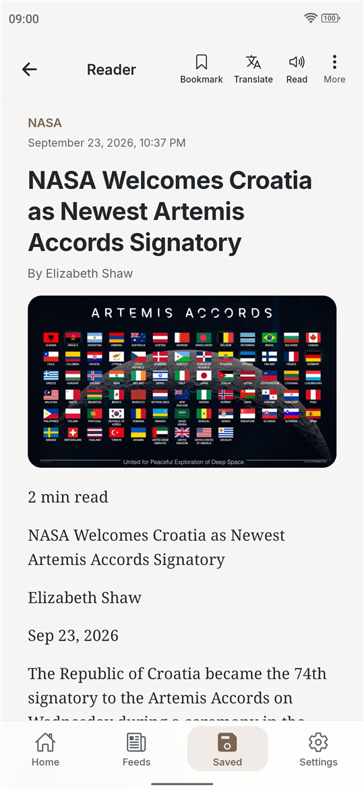
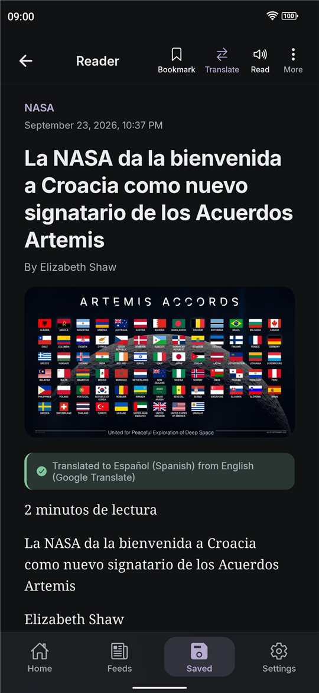
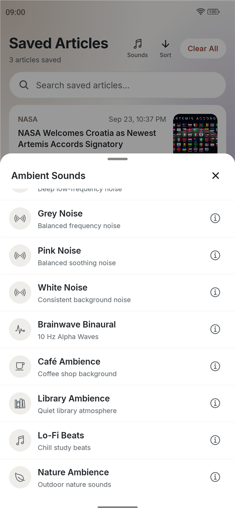
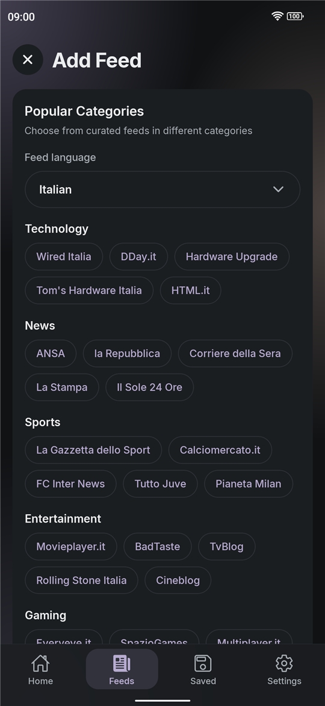

# FeedWell

An RSS reader for Android, made for people who want to follow the sites they like without ads, an account or tracking.

[Website](https://semo-lab.com/feedwell/) · [Privacy policy](https://semo-lab.com/feedwell/privacy-policy/) · [Contact](https://semo-lab.com/#contact)

  
  
  
  

## About

FeedWell follows the sites you choose through their RSS or Atom feeds and gathers their articles in one list. Before you read an article, it removes ads, tracking scripts and promotional blocks. There is no account to create, and your feeds, reading history and notes stay on your phone.

## Features

### Reading

- Ad-free articles: ads, tracking scripts and promotional blocks are removed before you read.
- Reader: articles open in a clean reader with a choice of fonts, including Atkinson Hyperlegible and the dyslexia-friendly OpenDyslexic.
- Translation: translate an article online with Google Translate or offline with language models you download, or let Auto-Translate do it as articles open.
- Read aloud: listen to an article with the phone's text-to-speech, at the speed you choose.
- Highlights and notes: highlight passages in saved articles and keep notes on what you read.
- Auto-scroll: the list and the reader scroll on their own after a pause, and a touch pauses them.
- Ambient sounds: noise, nature, café and lo-fi sounds play in the background while you read.
- Reduce Motion: fewer animations, and dots at the edges of the screen that move with the vehicle to ease motion sickness.

### Feeds

- Any feed: add an RSS or Atom feed, or paste a site's address and FeedWell finds its feed.
- Local feeds: hand-picked feeds for every language the app speaks, sorted by topic.
- Filter: narrow the list by read or unread, date, feed, saved articles, notes, starred feeds and pictures.
- Swipe actions: swipe an article right or left to mark it read, save, share or remove it, with each side set in Settings.
- Reading position: mark where you stopped in the list, and mark everything above it as read in one tap.
- A tidy list: hide a feed without unsubscribing, and remove articles so a refresh doesn't bring them back.
- Saved articles: keep an article with its full text to read later, also without a connection.

### Home, widget and look

- Customize Home: choose which sections Home shows and in what order.
- Home screen widget: a list or one article at a time, with a play button that moves on to the next article by itself. It can show all, unread or saved articles, from every feed or from one.
- Look: system, light or dark, a main color and an accent color, and AMOLED black.
- Languages: the app speaks many languages, including right-to-left Arabic, Farsi and Hebrew, and dates and numbers follow the language you pick.

### Your data

- Backups: one file holds your feeds, articles, saved articles, notes and settings, and restores on another phone by replacing or merging. Automatic backups can go to a folder you choose.
- Reading reminder: a notification scheduled on the phone if you haven't read for a while. You can turn it off.

## Privacy

Your feeds, articles, saved articles, notes and settings stay on your phone. FeedWell fetches feeds, articles and their images straight from the sites you follow. Translating online sends the article's text to Google Translate, and offline language models download from Google; in Offline only mode, translation happens on the phone. If a feed can't be reached while you add it, the app retries through public relay services. FeedWell has no account, no ads, no analytics and no tracking. The full text is in the [privacy policy](https://semo-lab.com/feedwell/privacy-policy/).

## Download

FeedWell is on [Google Play](https://play.google.com/store/apps/details?id=com.feedwell.app) for Android 7.0 and newer.

## Built with

React Native and Expo, React Navigation, react-native-rss-parser, Mozilla Readability with linkedom for article text, ML Kit for offline translation, Expo Speech for reading aloud, Expo AV for the ambient sounds, and AsyncStorage. The home screen widget and the motion cues are written in Kotlin.

## Development

1. Install Node.js, Java 17 and the Android SDK.
2. `npm install`
3. `npm run android` builds the app and starts it on a connected phone.
4. `npx expo export --platform android` compiles the code; run it before every commit.
5. Release builds are signed with a key that never enters this repository.

## Contributing, conduct and security

Bug reports and ideas are welcome: [CONTRIBUTING.md](CONTRIBUTING.md) says how. Everyone taking part follows the [code of conduct](CODE_OF_CONDUCT.md). Please report security problems privately, as [SECURITY.md](SECURITY.md) explains.

## License

Copyright (c) 2025 Sepehr Mohammady. All rights reserved. See [LICENSE](LICENSE).

FeedWell is one of the apps from [SeMo Lab](https://semo-lab.com/).
